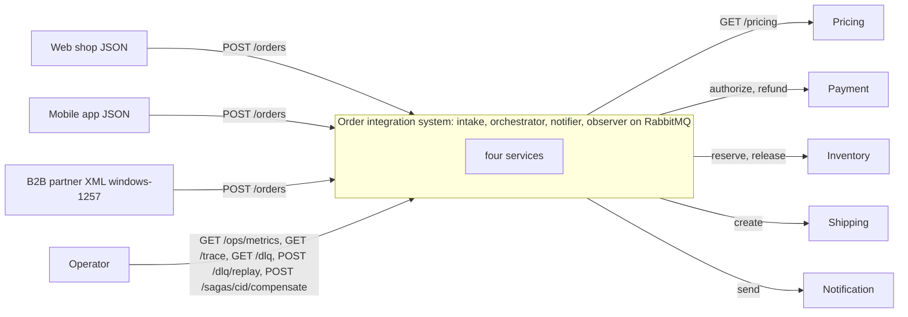
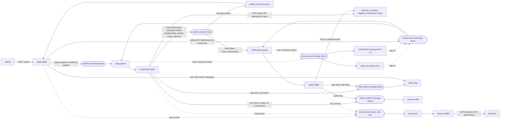

# Architecture

## System context

Orders arrive at intake in three formats. The system calls pricing synchronously and the four providers through the saga. An operator uses the HTTP endpoints of the services and the RabbitMQ management UI.

## Integration architecture

Intake publishes the canonical order to `orders.exchange`. The orchestrator consumes `saga.queue`, runs the saga over HTTP, and publishes lifecycle and outcome events to `orders.outcome`. Intake follows those events to keep `GET /orders` current, and the notifier consumes the failure events to send customer notices. Every service writes hop records to `trace.events`, and the observer stores them from `trace.store`.

A temporary failure goes through the retry queue back to its origin queue. After `MAX_RETRIES` attempts the message goes to `orders.dlq.exchange` and waits in `orders.dlq`. A message that cannot be parsed goes to `orders.invalid.exchange` and is never retried or replayed.

