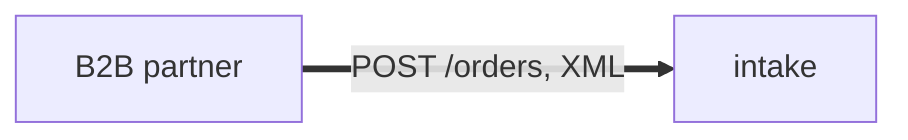

# Architecture

<!--
Capstone architecture (README §6, R-6.1). Keep the two ## headings exactly as
they are, and put one ```mermaid block under each. The stage 6 tests check
that both are there, and that the integration diagram names at least 6 of the
exchanges and queues in README §3.2. No manual points, but the defence starts
here: you explain your system from these two diagrams.

Comments like this one are prompts. They do not count as your text, and
nobody grades them: delete each one when you have written its section.

Mermaid renders on GitHub. Check yours there, or at https://mermaid.live.
-->

## System context

<!--
Your system from the outside: who sends it orders (web, mobile, a b2b
partner), who operates it, and which providers it calls (pricing, payment,
inventory, shipping, notification; Temporal if you build the advanced
component). Your system can be one box here, or your four services.

The syntax, not the answer. (A plain arrow is two dashes and a ">"; an HTML
comment cannot show one, so this example uses the thick arrow.)


-->

## Integration architecture

<!--
Inside the system: your services, every exchange and queue of README §3.2,
and the paths a message can take. Show the retry path (the retry queue and
its way back), the DLQ and the invalid channel, the outcome events and who
consumes them, and the wire tap into trace.store. Label an edge with its
routing key where one matters.

Draw what your code does, not what the brief says. If your notifier
consumes something the brief does not mention, it is in the diagram.
-->
